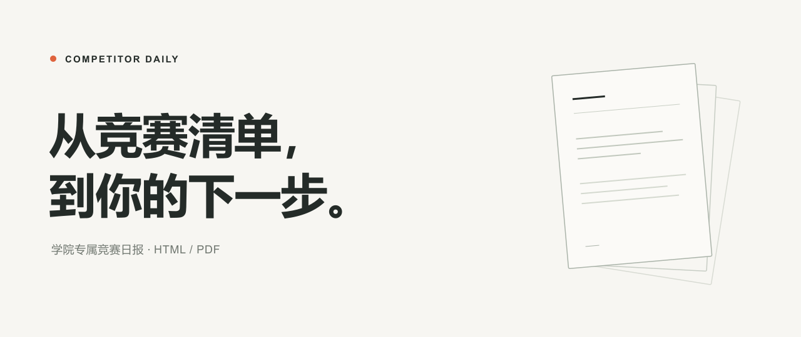

<!-- competitor-daily:product-home -->
<p align="center">
  
</p>

<p align="center">
  <a href="https://oliverli1701-eng.github.io/competitor-daily/">项目展示</a> ·
  <a href="https://github.com/oliverli1701-eng/competitor-daily/releases/tag/v1.0.0">下载 Skill</a> ·
  <a href="https://oliverli1701-eng.github.io/competitor-daily/docs/demo/index.html">查看日报样例</a>
</p>

<p align="center">
  <sub>开源 Agent Skill · Python 3.11+ · HTML / PDF</sub>
</p>

## 为你自己的学院，生成你自己的日报

每个学院都有自己的认可清单。Competitor Daily 让 Agent 先读懂那份清单，再查官方赛事通知，把报名状态、截止日期、线上或线下、参赛要求和提交材料整理到一份本地网页与 PDF 中。大学、学院、标题、配色可以编辑；不同用户的名单、密钥和历史状态保存在独立工作目录。

| 你提供 | 日报机完成 | 你得到 |
| --- | --- | --- |
| 学院竞赛清单 | 导入、核对并追踪名单内赛事 | 专属竞赛目录 |
| 自己的 API 或 Agent 检索能力 | 查官方来源、保留依据、比较变化 | 四个有重点的日报栏目 |
| 大学、学院和品牌设置 | 同一份数据渲染网页与文档 | 本地 HTML + 可下载 PDF |

**新开放报名 · 赛事重要更新 · 临近截止提醒 · 正在进行的比赛**。同一赛事可以进入多个栏目，栏目数量不会被误当作赛事总数。缺乏依据的字段直接省略，不让“尚未明确”淹没有用信息。

## 一分钟安装

需要 **Python 3.11+**。完整 Skill 发行包自带运行源码、模板和 PDF 字体；首次运行仍需安装 Python 依赖，实时检索需要网络和你自己的凭证。

**Codex**：下载完整 Skill ZIP，解压后运行：

[下载完整 Skill · v1.0.0](https://github.com/oliverli1701-eng/competitor-daily/releases/download/v1.0.0/competitor-daily-v1.0.0.zip) · [发行说明与校验值](https://github.com/oliverli1701-eng/competitor-daily/releases/tag/v1.0.0)

```bash
python -m pip install -r runtime/requirements.txt
python scripts/install.py
```

这会安装到 `$CODEX_HOME/skills/competitor-daily`；未设置 `CODEX_HOME` 时使用 `~/.codex/skills/competitor-daily`。已有目录会保留并提示，不直接覆盖。需要其他位置可传入 `--target /path/to/skills/competitor-daily`。在新对话中调用 `$competitor-daily`。

**WorkBuddy**：进入「专家·技能·连接器 → 技能 → 添加技能 → 上传技能」，选择完整 Skill ZIP。该入口依据 [WorkBuddy 官方技能文档](https://www.codebuddy.cn/docs/workbuddy/From-Beginner-to-Expert-Guide/Function-Description/Skills-Market)。本项目提供标准 `SKILL.md` 与 Python 脚本，实际执行和定时能力以你的 Agent 版本为准。

**其他 Agent**：让支持本地 Skill 的 Agent 读取 [SKILL.md](skills/competitor-daily/SKILL.md)，或直接使用下面的 Python CLI。没有绑定某一家 Agent 的私有运行接口。

## 三步开始

### 01 / 给它你的清单

在 Agent 中发送：

> 使用 competitor-daily，在一个独立工作目录里建立我的竞赛日报机。我的大学是“示例大学”，学院是“未来技术学院”。请导入我提供的竞赛清单，对照原件核对名称和认可等级，有歧义再问我，然后开始检索。

支持文本型 PDF、DOCX、XLSX、CSV、JSON、Markdown 与文本。图片扫描件先由 Agent 的 OCR/文档工具转为可核对文本；Agent 核对清单无误后进入正式检索，有实质歧义时再向你确认。

### 02 / 选择你自己的检索方式

- **自己的 DeepSeek API**：在工作目录的 `.env` 中配置 `DEEPSEEK_API_KEY`。搜索和模型调用费用由你的账号承担。
- **自己的 Agent**：让 Agent 用已有的检索工具核验官方资料，生成研究批次，再用 `--from-research` 渲染。无需另配 DeepSeek Key，Agent 自身的 Token 与工具仍按你的平台计费。

不需要把密码、Token 发给作者；项目不提供共享密钥或公共算力。

### 03 / 打开你的日报

让 Agent 生成日报并打开本地 HTML；同一份数据同时生成 PDF。也可以先运行 `demo` 看版式与品牌效果，再进行正式研究。

如果你希望每日更新，Agent 可以在你明确要求后配置平台任务或系统定时器。机器在线、网络、权限和凭证仍需可用；**安装本身不会创建定时任务**。

## 喜欢动手？直接运行

完整源码仓库也可使用：

```bash
git clone https://github.com/oliverli1701-eng/competitor-daily.git
cd competitor-daily
python -m venv .venv
# 激活虚拟环境后执行：
python -m pip install -r requirements.txt

python -m contest_daily --root ./my-daily init --university "示例大学" --college "未来技术学院"
python -m contest_daily --root ./my-daily import-catalog ./my-competitions.pdf
# 对照原件核对草稿无误后：
python -m contest_daily --root ./my-daily confirm-catalog
python -m contest_daily --root ./my-daily doctor
python -m contest_daily --root ./my-daily run
```

正式运行前，按 `doctor` 和 `sources --help` 的提示完成凭证及官方来源配置。CLI 帮助使用 `python -m contest_daily --help`；安装后的 Skill 通过 `scripts/competitor_daily.py` 提供同一组命令。

## 让它看起来属于你的学院

编辑工作目录里的 `config/profile.json`，无需修改页面源码：

```json
{
  "university": "你的大学",
  "college": "你的学院",
  "report_title": "竞赛日报",
  "english_title": "COMPETITION DAILY",
  "brand_name": "Competitor Daily",
  "accent_color": "#ec744d"
}
```

品牌配置用于 HTML 与 PDF。已有配置文件中的其他字段请保留。更换学校不会覆盖旧报告，也不会自动沿用作者的认可清单。

## 开放扩展，也保留事实边界

程序将**文档导入、认可清单、来源注册、事实提取、历史状态、HTML/PDF 渲染**分开。你可以扩展输入解析器、检索供应商、赛事字段和部署方式，沿用校验与状态比较能力。见 [架构与扩展](docs/architecture.md)。

搜索摘要用于发现线索，事实应来自已核验的官方页面或附件。公开日报仅呈现得到依据的字段。演示页面明确标注为虚构数据，不是真实赛事或当前报名建议。

## 日报档案继续保留

这个仓库同时保留作者的实际日报，按 `年 / 月 / ISO 周 / 日期` 归档。你可以在 [历史日报入口](https://oliverli1701-eng.github.io/competitor-daily/archive/) 阅读网页和下载 PDF；该实例的运行身份、私有源文件与 API Key 不属于开源发行内容。

## License

代码与项目原创设计采用 [MIT License](LICENSE)。PDF 内嵌字体遵循其 [单独许可证](assets/FONT-LICENSE.txt)；赛事通知、官网内容及第三方材料仍归各自权利人所有。

<p align="center"><b>Your college. Your competitions. Your tokens.</b><br /><sub>Built for your next opportunity.</sub></p>
